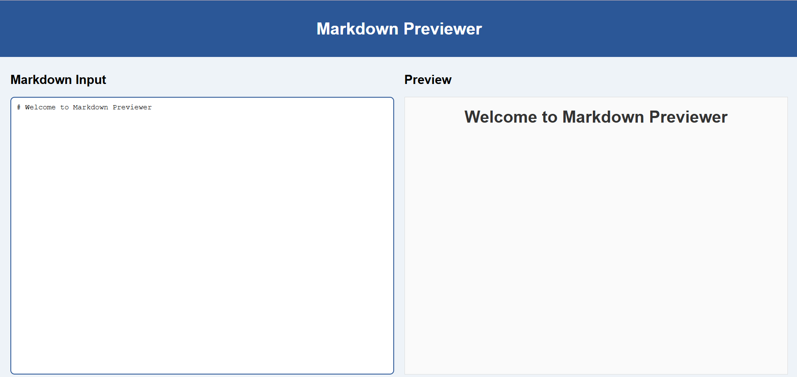
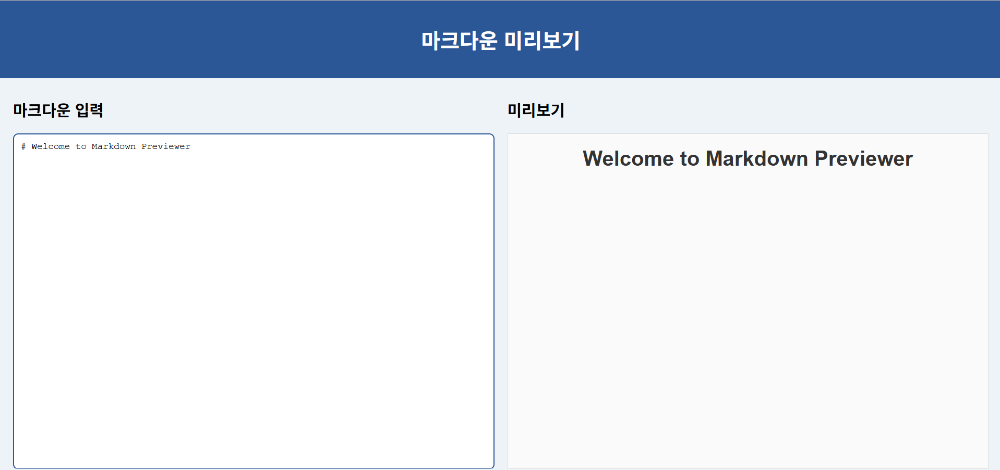
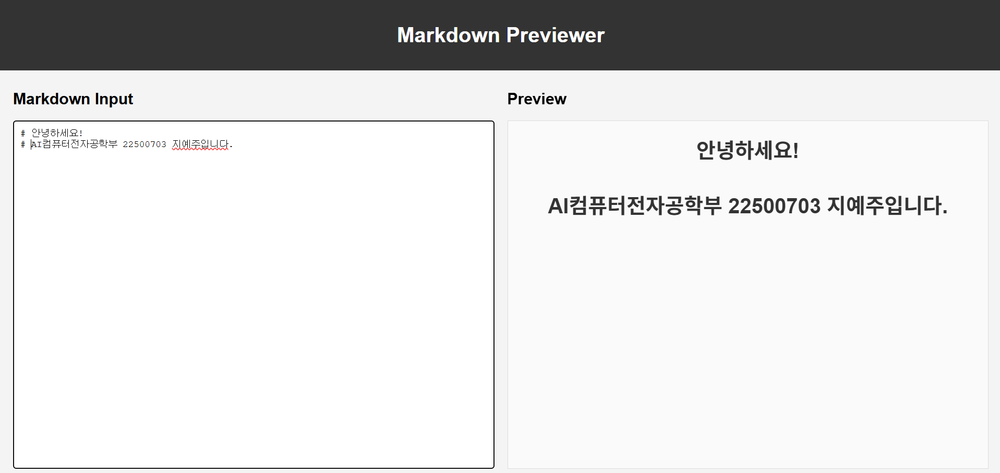
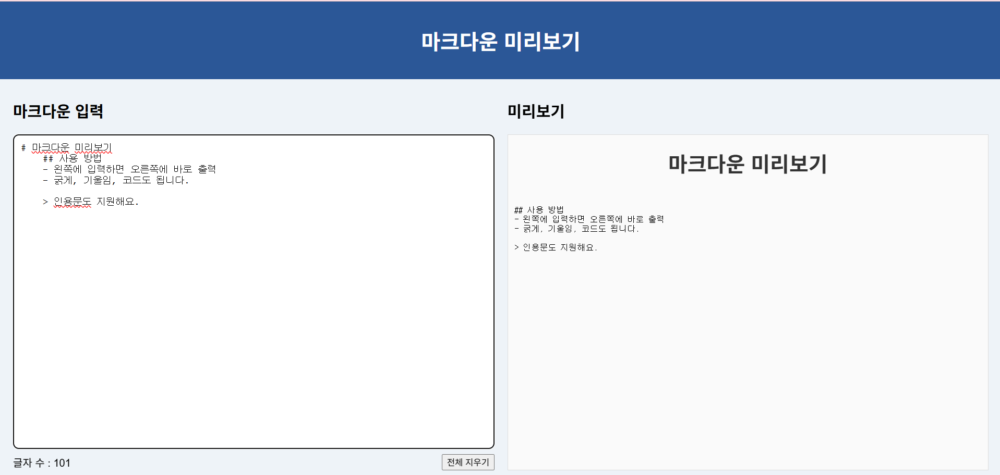

# Markdown Previewer

## 1. Project Information

### 프로젝트 소개
마크다운 문법(제목, 목록, 굵게, 코드 블록 등)을 입력하면 HTML로 변환된 결과를 바로 보여주는 마크다운 에디터입니다.
서버나 데이터베이스 없이 브라우저에서만 동작합니다.

### 선택 이유
처음에는 Create React App('react-scripts') 기반의 tic-tac-toe 프로젝트를 골랐는데, Vercel 배포 중 오래된 빌드 도구가 최신 Node.js와 맞지 않아서 생긴 오류로 인해 배포가 되지 않아서 최신 빌드 도구인 Vite를 쓰는 프로젝트를 고르게 되었습니다.

### 원본 URL
https://github.com/oopshell/markdown-previewer

### 주요 기능
1. 실시간 미리보기 : 입력할 때마다 미리보기 화면이 즉시 바뀝니다.
2. 마크다운 -> HTML 변환 : marked 라이브러리로 제목, 목록, 링크, 이미지, 코드 블록 등을 HTML로 바꿔서 보여줍니다.
3. 좌우 분할 화면 : 입력 영역과 미리보기 영역을 한 화면에서 나란히 볼 수 있습니다.

## 2. Installation
### 설치 및 실행 방법
```bash
git clone https://github.com/2026-2-OSS/assign11-c01-22500703.git
cd assign11-c01-22500703
npm install
npm run dev
```
실행 후 브라우저에서 `http://localhost:5173/`에 접속합니다.

### 실행 화면


## 3. Source Code Exploration

### Project Structure
- 'index.html' : 브라우저가 처음 여는 파일입니다. '<div id="root">' 안에 React 화면이 그려집니다.
- 'src/main.jsx' : 앱의 시작점으로, 'App' 컴포넌트를 'root'에 연결합니다.
- 'src/App.jsx' : 입력된 글을 state로 관리하고, 'Editor'와 'Preview'를 배치합니다.

### React Component
- 'Editor' : 마크다운을 입력하는 textarea 입니다. 입력이 바뀌면 App의 state를 변경합니다.
- 'Preview' : App에게 받은 글을 HTML로 바꿔서 보여줍니다.

### Code Analysis
`src/components/Preview.jsx`
```jsx
import React from 'react';
import { marked } from 'marked';

const Preview = ({ markdown }) => {
  return (
    <div className="preview">
      <h2>Preview</h2>
      <div
        dangerouslySetInnerHTML={{ __html: marked(markdown) }}
      />
    </div>
  );
};

export default Preview;
```

- `({ markdown })` : App이 props로 넘겨준 마크다운 글을 받습니다.
- `marked(markdown)` : 마크다운을 HTML 문자열로 바꿉니다.
- `dangerouslySetInnerHTML` : HTML 문자열을 글자가 아니라 실제 HTML로 화면에 그립니다.

## 4. Customizing

### Text
`src/App.jsx` | `Markdown Previewer` | `마크다운 미리보기`
`src/components/Editor.jsx` | `Markdown Input` | `마크다운 입력`
`src/components/App.jsx` | `Type your markdown here...` | 기본 데이터를 한 줄 제목에서 사용법 예시가 담긴 여러 줄 마크다운으로 변경
`src/components/Preview.jsx` | `Preview` | `미리보기`

변경 전 | 변경 후
 | 

### Style
`src/App.css` | `body` | `background-color`
`src/App.css` | `textarea` | `border`

변경 전 | 변경 후
 | 

### UI/Data
`src/components/Editor.jsx` | 입력창 아래에 글자 수 표시와 "전체 지우기" 버튼 추가
`src/App.css` | 글자 수와 버튼을 정렬하는 `.editor-footer` 스타일 추가

```jsx
<div className="editor-footer">
  <span>글자 수: {markdown.length}</span>
  <button onClick={() => onChange('')}>전체 지우기</button>
</div>
```

변경 전 | 변경 후
 | 

## 5. Deployment
- Vercel URL : https://markdown-previewer-ecru-seven.vercel.app/

## 6. Weekly Review

### 새롭게 배운 내용
1. 오래된 `react-scripts`는 최신 Node.js에서 에러가 나고, Vite 같은 최신 빌드 도구로는 문제가 없다는 것
2. 부모(App)가 state를 갖고 props로 자식 컴포넌트에 전달하는 구조
3. 마크다운에서 줄 앞에 공백이 4칸 이상 있으면 코드 블록으로 처리된다는 것

### 어려웠던 점과 해결 방법
- 처음 고른 프로젝트가 Vercel 빌드 에러로 배포되지 않아, 로그에서 원인을 찾고 Vite 기반 프로젝트로 바꿨습니다.

### AI 활용 내용 및 느낀 점
- AI 활용 : 빌드 에러 원인 분석, 프로젝트 추천, 오류 수정
- 직접 한 작업 : 코드 분석, Clone 및 실행, 코드 수정 및 테스트
- 느낀 점 : 이번 과제를 통해 다양한 내용을 새롭게 배울 수 있었습니다. 처음에는 Vercel 배포 과정에서 프로젝트가 최신 Node.js 버전과 맞지 않아 배포가 되지 않았는데, 이 에러의 원인을 찾아보면서 빌드 도구와 Node.js 버전의 관계를 알게 되었습니다. 또한 마크다운 프로젝트의 코드를 분석하면서, 부모 컴포넌트가 state를 갖고 props로 자식 컴포넌트에 전달하는 구조가 실제 코드에서 어떻게 만들어지는지 직접 확인할 수 있었습니다.